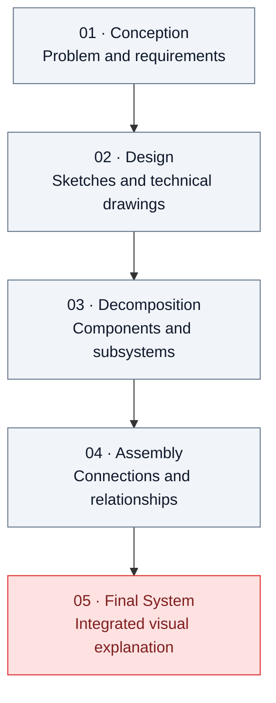
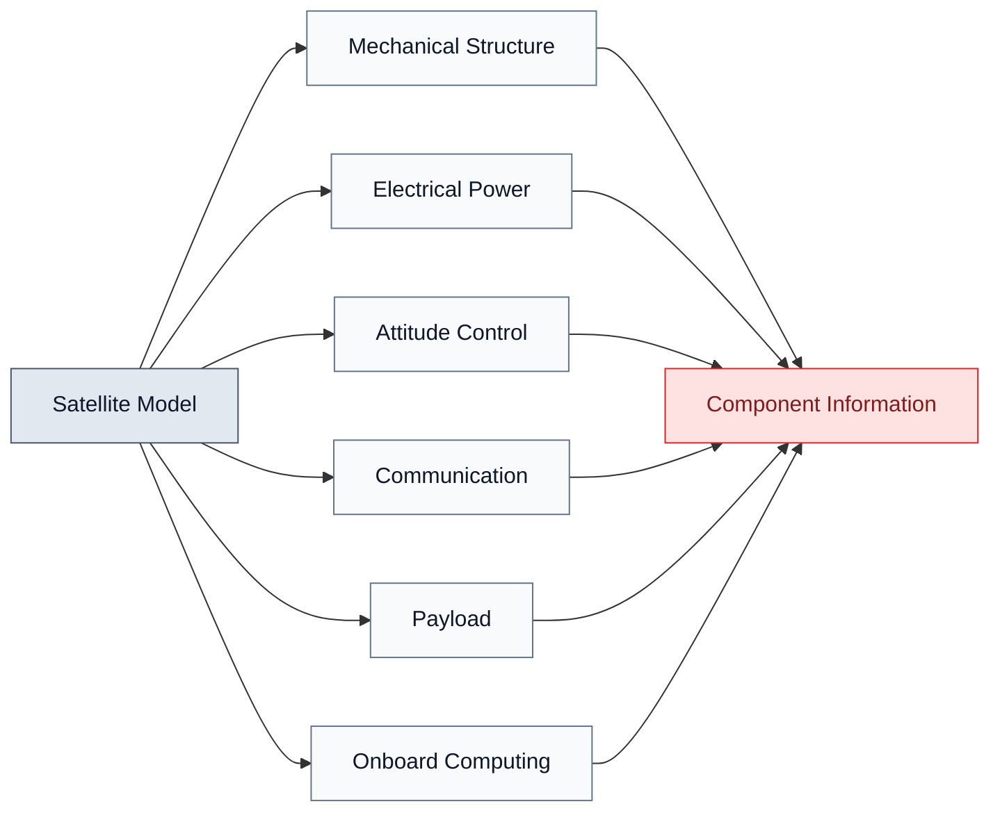
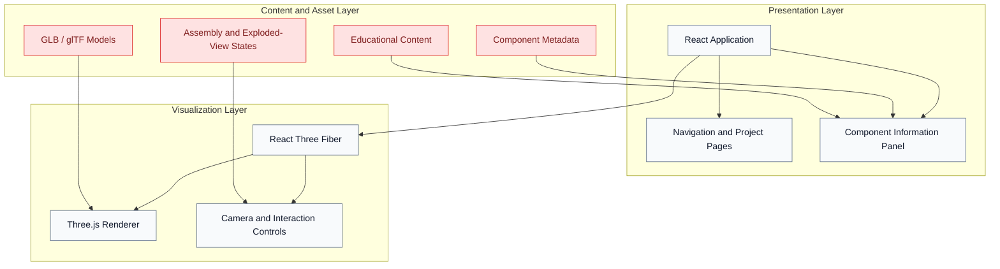

<div align="center">

# Engineering Atlas

### Interactive Engineering Exploration Platform

**Explore the systems. Understand the engineering.**

[](#-project-status)
[](https://react.dev/)
[](https://www.typescriptlang.org/)
[](https://threejs.org/)
[](https://www.blender.org/)

**Academic Project · Introduction to Engineering · University of Brasília (UnB/FGA)**

[Overview](#-overview) ·
[Concept](#-core-concept) ·
[Architecture](#-planned-architecture) ·
[Roadmap](#-roadmap) ·
[Getting Started](#-getting-started) ·
[Limitations](#-scope-and-limitations)

</div>

---

## Overview

**Engineering Atlas** is an educational platform designed to introduce students to engineering through interactive technical illustrations, three-dimensional models, exploded views, and step-by-step explorations of engineered systems.

Developed in the context of **Introduction to Engineering at the University of Brasília's Gama Faculty (FGA)**, the project aims to help students understand the different engineering disciplines and explore their applications before choosing an academic path.

Instead of presenting engineering solely through finished products, the platform reveals the components, subsystems, design decisions, and relationships that make each system work.

The goal is to combine **technical drawing, 3D visualization, and engineering education** in an interactive browser-based experience.

> [!NOTE]
> This repository is in its initial development stage. The concepts and features described below represent the project vision and roadmap; they should not be interpreted as implemented functionality.

---

## Core Concept

Each engineering discipline will be represented by a carefully selected project that users can explore interactively.

The experience is organized around five conceptual stages:



### Core Features

- **Technical Illustrations:** Explore the structure and design of engineering systems.
- **Interactive 3D Models:** Rotate, zoom, and inspect objects directly in the browser.
- **Exploded Views:** Separate components visually to reveal internal organization.
- **Component Inspection:** Select individual parts to access descriptions and technical information.
- **Step-by-Step Exploration:** Follow the conceptual development of a project.
- **Assembly Sequences:** Observe how components relate to the final system.
- **Educational Content:** Understand the purpose of each component and its contribution to the system.
- **Interdisciplinary Connections:** Discover how different engineering disciplines work together.

The interactions are intended to communicate engineering concepts visually, without requiring a full physics or engineering simulation.

---

## Initial Project: Satellite Anatomy

The first planned experience focuses on an Earth-observation satellite as an introduction to aerospace engineering.

The satellite will serve as an example of a complex system composed of interconnected subsystems.

### Planned Components

| Subsystem | Educational Focus |
| --- | --- |
| Mechanical Structure | Structural organization, support, and component integration |
| Electrical Power | Solar panels, power generation, storage, and distribution |
| Attitude Determination and Control | Orientation, sensors, actuators, and attitude control |
| Communication | Antennas, radio systems, and data transmission |
| Payload | Mission objectives, instruments, and Earth observation |
| Onboard Computing | Command processing, data handling, and subsystem coordination |

### Planned Interaction



The intended experience will allow users to select a subsystem, inspect its components, and understand its role within the complete satellite.

The first implementation will prioritize visual clarity and educational accuracy over geometric complexity.

---

## Engineering Disciplines

The long-term objective is to create a collection of interactive projects representing the engineering disciplines offered at FGA.

Potential projects include:

| Engineering Area | Example Project | Main Interaction |
| --- | --- | --- |
| Aerospace | Earth-observation satellite | Exploded views and subsystem inspection |
| Automotive | Vehicle assembly or suspension | Mechanical component exploration |
| Electronic | Electronic sensing circuit | Component assembly and visual signal explanation |
| Energy | Photovoltaic power system | Visual energy-flow exploration |
| Software | Autonomous navigation system | Architecture and data-flow exploration |

These examples are preliminary. The final projects will be selected according to their educational value, technical relevance, and feasibility within the available development time.

Each project will have a distinct interaction model while sharing the same underlying platform.

---

## Planned Architecture

The application is planned around three main layers:



### Technology Stack

| Technology | Purpose |
| --- | --- |
| React | Component-based user interface |
| TypeScript | Typed application logic |
| Vite | Development environment and build tooling |
| Three.js | Browser-based 3D rendering |
| React Three Fiber | Three.js integration with React |
| React Three Drei | Reusable helpers for 3D scenes |
| Blender | 3D modeling, technical illustration, and asset preparation |
| GLB / glTF | 3D asset delivery to the browser |

This stack is a starting point and may evolve as the project's requirements become clearer.

### Visualization Approach

The visual language will combine elements of technical drawing and interactive 3D visualization.

Planned visual elements include:

- Neutral backgrounds and technical grids.
- Fine outlines and restrained red accents.
- Annotations, callouts, and reference lines.
- Exploded component arrangements.
- Selectable parts and subsystem highlighting.
- Contextual descriptions alongside the 3D viewport.

Blender will be used to prepare the models and visual assets. Browser-side interactions will be implemented separately so that individual components can be selected and manipulated.

---

## Roadmap

### Phase 1 — Foundation

- [ ] Define the visual identity and interface.
- [ ] Establish the application structure.
- [ ] Create the main atlas page.
- [ ] Design the project navigation system.
- [ ] Prepare the first technical illustration.

### Phase 2 — Satellite Prototype

- [ ] Create the initial 3D satellite model.
- [ ] Prepare separate meshes for major subsystems.
- [ ] Integrate the model into the browser.
- [ ] Implement camera rotation and zoom.
- [ ] Add component selection and highlighting.
- [ ] Implement the exploded-view interaction.
- [ ] Create component information panels.

### Phase 3 — Educational Experience

- [ ] Organize the satellite project into conceptual stages.
- [ ] Add technical drawings and annotations.
- [ ] Explain subsystem functions and relationships.
- [ ] Create a visual assembly sequence.
- [ ] Review technical accuracy and educational clarity.

### Phase 4 — Platform Expansion

- [ ] Define a reusable project and component data structure.
- [ ] Develop additional engineering projects.
- [ ] Create discipline-specific interactions.
- [ ] Improve accessibility and responsive layouts.
- [ ] Optimize 3D assets and browser performance.

---

## Getting Started

### Prerequisites

The development environment will require:

- [Node.js](https://nodejs.org/) and npm
- [Git](https://git-scm.com/)
- [Visual Studio Code](https://code.visualstudio.com/)
- A modern browser with WebGL support

### Installation

Once the initial application files are available, clone the repository:

```bash
git clone https://github.com/YOUR_USERNAME/engineering-atlas.git
cd engineering-atlas
```

Install the dependencies:

```bash
npm install
```

Start the development server:

```bash
npm run dev
```

Open the local URL printed by Vite in your browser.

> [!IMPORTANT]
> Replace `YOUR_USERNAME` with the actual GitHub username or organization that owns the repository. These instructions describe the intended workflow; they are not evidence that the application has already been implemented.

---

## Planned Repository Structure

The following structure describes the intended organization as the project develops. Directories will be added as needed.

```text
engineering-atlas/
├── public/
│   └── models/
│       └── .gitkeep
├── src/
│   ├── components/
│   │   ├── layout/
│   │   ├── viewer/
│   │   └── engineering/
│   ├── data/
│   ├── features/
│   │   └── satellite/
│   ├── pages/
│   ├── styles/
│   ├── types/
│   ├── App.tsx
│   └── main.tsx
├── docs/
│   └── .gitkeep
├── README.md
├── package.json
├── tsconfig.json
└── vite.config.ts
```

The final structure will depend on the actual implementation and should not be created in advance merely to match this diagram.

---

## Scope and Limitations

Engineering Atlas is intended as an educational visualization platform.

Its initial scope focuses on:

- Visual exploration of engineering systems.
- Conceptual explanations of components and subsystems.
- Technical illustrations and three-dimensional representations.
- Guided exploration of engineering design concepts.

The initial project does not aim to provide:

- Validated structural or thermal analysis.
- Orbital mechanics or spacecraft dynamics simulation.
- Electrical circuit simulation.
- Professional CAD functionality.
- Certified engineering design or verification.

Animations and interactive models will illustrate concepts and relationships. They will not, by themselves, validate the physical behavior or engineering performance of a system.

Technical descriptions will be developed using appropriate educational and engineering references.

---

## Educational Purpose

The project is designed to support introductory engineering education by making complex systems easier to explore and understand.

By interacting with the components of an engineered object, students can begin to investigate questions such as:

- What problem does this system solve?
- Why is each component necessary?
- How do the components interact?
- Which engineering disciplines contribute to the system?
- What trade-offs influence design decisions?
- How does an initial concept evolve into an integrated system?

The objective is not merely to show what engineers build, but to introduce how engineering systems are organized and designed.

---

## Contributions

Suggestions, technical feedback, educational references, and ideas for future projects are welcome.

Contributions should prioritize:

- Technical accuracy.
- Clear educational explanations.
- Maintainable code.
- Accessible visual communication.
- Efficient and reusable 3D assets.

Contribution guidelines may be formalized as the project grows.

---

## License

No license has been selected yet.

The licensing terms for the source code, original models, illustrations, and third-party assets will be defined before granting explicit reuse and distribution permissions.

---

<div align="center">

**Engineering Atlas**

*Explore the systems. Understand the engineering.*

Developed as an academic project at the University of Brasília (UnB/FGA).

</div>
